# apxinf-gr00t-fp4fp8-ptqad

**APXInf × GR00T：NVFP4 W4A4 训练后量化、QAD 演示恢复与 OPD 教师监督。**

[下载科学结果审阅包（非最终发布包，7 张截图待补）](https://github.com/zhaosiying12138/apxinf-gr00t-fp4fp8-ptqad/raw/refs/heads/main/paper/apxinf-gr00t-fp4fp8-ptqad-review.zip)

视觉—语言—动作模型把相机图像、语言指令和机器人状态映射为动作。本项目研究 GR00T N1.7 在更广四位量化覆盖下，能否通过低秩恢复保持 LIBERO 闭环任务能力。`ptqad` 是 PTQ 与 QAD 的组合名称；当前主实验采用全 NVFP4 W4A4 RTN 基座；同覆盖校准 GPTQ 对照未执行，不据此主张超过先进 PTQ。仓库也提供 APXInf 的 NVFP4/FP8 算子、块尺度布局和原生执行基准。

项目将量化、恢复与评测连成以下流程：

```text
BF16 GR00T → NVFP4 W4A4 PTQ → QAD
                              ├─ continued-QAD：同演示预算续训
                              └─ OPD：演示损失 + 学生状态教师监督
```

QAD 冻结量化基座，只用成功演示更新低秩旁路；OPD 在 QAD 学生访问的状态上加入 BF16 教师速度标签。正式评测用相同任务、初态、种子和回合预算比较五臂，分别衡量量化影响、演示恢复与教师监督收益。

## 阅读入口与结果状态

**实验已完成且冻结；本页为数据完整的审阅版。七个发布截图环节待补，尚非最终发布包。** 以下数值来自本轮 v12 五臂完整评测与固定观测诊断。最终生成器因截图未补齐而拒绝生成正式交付；这里的审阅更新不表示最终发布校验已通过。

- [中文论文 HTML](paper/paper.html)：离线阅读，含公式、图表、源码解读和复现附录。
- [知乎 Markdown](paper/zhihu/article.md)：与 HTML 共用正文，保留待补截图标识。
- [最终实验清单](paper/evidence/final_manifest.json)、[五臂结果与配对统计](paper/evidence/final_results.json)、[逐回合配对记录](paper/evidence/paired_comparison.json)。
- [完整复现说明](docs/reproduce-ptqad.md)与[QVLA 对照审阅](docs/QVLA_GAP_REVIEW_20261006.md)。

在 LIBERO-10 每臂 160 个配对回合中，RTN W4A4 PTQ 为 138/160（86.25%），QAD 为 145/160（90.625%）；QAD 达到与 BF16 相同的成功率点估计。QAD 相对 PTQ 为 +4.375 个百分点。这一恢复仅指点估计，配对统计尚不能确认 QAD 优于 PTQ。

QAD+OPD 为 144/160（90%），continued-QAD 为 104/160（65%）。OPD 相对同演示更新预算续训为 +25.000 个百分点，配对区间与 Holm 校正支持这一优势；相对 QAD 为 -0.625 个百分点。本实验未显示 OPD 超过 QAD 的额外成功率增益。

## 已完成的 v12 实验指标

协议 `w4a4-recovery-v12-rtn`，SHA-256 `31addae911f92db65dda3c1c3145e8b798dca46c49a5ae12bbe10d232b5a4521`。五臂各为十任务 × 16 回合，合计 800 个正式回合；开发集用于选择，未混入下表。

| 配置 | 成功回合 | macro_success_rate |
|---|---:|---:|
| BF16 | 145/160 | 90.625% |
| W4A4 PTQ | 138/160 | 86.250% |
| PTQ + QAD | 145/160 | 90.625% |
| continued-QAD | 104/160 | 65.000% |
| PTQ + QAD + OPD | 144/160 | 90.000% |

### 配对差异与不确定性

| 比较 | 点差 / pp | 95% 配对 CI / pp | 不一致回合 | 精确 McNemar p | Holm p |
|---|---:|---:|---:|---:|---:|
| PTQ − BF16 | -4.375 | [-9.375, +0.625] | 21 | 0.1892 | 0.5677 |
| QAD − PTQ | +4.375 | [-1.875, +10.000] | 29 | 0.2649 | 0.5677 |
| OPD − QAD | -0.625 | [-6.250, +5.000] | 25 | 1 | 1 |
| OPD − continued-QAD | +25.000 | [+18.125, +31.875] | 54 | 2.292e-08 | 9.167e-08 |

差值单位为百分点。前三项区间包含零，不能据此确认量化退化、QAD 改善或 OPD 超过 QAD，也不构成等价性证明；OPD 相对 continued-QAD 的优势得到本设置下的配对区间和校正检验支持。两臂匹配演示读取数与更新次数，OPD 另有教师标注和学生探针计算，因此不属于相同总计算预算。

| 比较 | 两者成功 | 仅前者成功 | 仅后者成功 | 两者失败 | 不一致回合 |
|---|---:|---:|---:|---:|---:|
| PTQ − BF16 | 131 | 7 | 14 | 8 | 21 |
| QAD − PTQ | 127 | 18 | 11 | 4 | 29 |
| OPD − QAD | 132 | 12 | 13 | 3 | 25 |
| OPD − continued-QAD | 97 | 47 | 7 | 9 | 54 |

表中“前者/后者”沿用比较标题顺序；例如 OPD − continued-QAD 的“仅前者成功”指 OPD 成功、continued-QAD 失败。

- 区间方法：`paired percentile bootstrap, resampling episodes within each fixed task`，置信度 95.0%，重复次数 20000，seed `20261002`，分位数规则 `linear interpolation, rank (B-1)*p`。
- 检验方法：`exact two-sided McNemar on paired episode outcomes`；显著性水平 `0.05`；多重比较 `Holm correction across the four named contrasts`。

### 正式回合运行收据

| 臂 | 成功率（macro/micro） | wall / s | seed | purpose | 完成任务 |
|---|---:|---:|---:|---|---:|
| BF16 | 90.62% / 90.62% | 7,053.161 s | 970000 | `heldout` | 10/10 |
| W4A4 PTQ | 86.25% / 86.25% | 16,424.459 s | 970000 | `heldout` | 10/10 |
| PTQ + QAD | 90.62% / 90.62% | 16,584.657 s | 970000 | `heldout` | 10/10 |
| continued-QAD | 65.00% / 65.00% | 20,889.620 s | 970000 | `heldout` | 10/10 |
| PTQ + QAD + OPD | 90.00% / 90.00% | 14,571.280 s | 970000 | `heldout` | 10/10 |

### 逐任务成功数

| 任务 | BF16 | W4A4 PTQ | PTQ + QAD | continued-QAD | PTQ + QAD + OPD |
|---|---:|---:|---:|---:|---:|
| `LIVING_ROOM_SCENE2_put_both_the_alphabet_soup_and_the_tomato_sauce_in_the_basket` | 15/16 | 16/16 | 16/16 | 1/16 | 13/16 |
| `LIVING_ROOM_SCENE2_put_both_the_cream_cheese_box_and_the_butter_in_the_basket` | 16/16 | 16/16 | 15/16 | 5/16 | 15/16 |
| `KITCHEN_SCENE3_turn_on_the_stove_and_put_the_moka_pot_on_it` | 15/16 | 16/16 | 15/16 | 15/16 | 15/16 |
| `KITCHEN_SCENE4_put_the_black_bowl_in_the_bottom_drawer_of_the_cabinet_and_close_it` | 13/16 | 11/16 | 15/16 | 16/16 | 16/16 |
| `LIVING_ROOM_SCENE5_put_the_white_mug_on_the_left_plate_and_put_the_yellow_and_white_mug_on_the_right_plate` | 15/16 | 13/16 | 15/16 | 9/16 | 16/16 |
| `STUDY_SCENE1_pick_up_the_book_and_place_it_in_the_back_compartment_of_the_caddy` | 14/16 | 15/16 | 14/16 | 16/16 | 15/16 |
| `LIVING_ROOM_SCENE6_put_the_white_mug_on_the_plate_and_put_the_chocolate_pudding_to_the_right_of_the_plate` | 16/16 | 13/16 | 12/16 | 11/16 | 15/16 |
| `LIVING_ROOM_SCENE1_put_both_the_alphabet_soup_and_the_cream_cheese_box_in_the_basket` | 15/16 | 16/16 | 14/16 | 13/16 | 15/16 |
| `KITCHEN_SCENE8_put_both_moka_pots_on_the_stove` | 12/16 | 8/16 | 16/16 | 10/16 | 14/16 |
| `KITCHEN_SCENE6_put_the_yellow_and_white_mug_in_the_microwave_and_close_it` | 14/16 | 14/16 | 13/16 | 8/16 | 10/16 |

QAD 相对 PTQ 的净增量为 7 次成功，其中双摩卡壶任务贡献 +8，其余任务合计 −1，不能写成各任务普遍恢复。OPD 相对 continued-QAD 的 40 次净增量中，两个入篮任务与双杯分盘合计贡献 29 次；十任务中七项增加、两项不变、一项减少。两个追加训练分支来自同一 QAD 起点，OPD 没有在已经下降的 continued-QAD 检查点上继续训练。

### 固定观测上的完整动作诊断

固定十个任务各八个观测，共 80 个窗口；五臂使用相同观测和经数值核验的初始噪声，各自完成四步积分，再比较有效的 16×7 动作。观测来自已用于 QAD 的教师成功轨迹，因此这项测量解释训练分布上的动作拟合，不衡量未见状态泛化。

| 配置（相对 BF16） | 归一化动作 MSE | 平移控制量 MSE | 旋转控制量 MSE | 夹爪指令不一致 |
|---|---:|---:|---:|---:|
| W4A4 PTQ | 0.01111 | 0.00355734 | 0.000234355 | 0.78% |
| QAD | 0.00883637 | 0.00268328 | 0.000154304 | 0.78% |
| continued-QAD | 0.00915725 | 0.00257093 | 0.000158991 | 0.86% |
| QAD + OPD | 0.0089183 | 0.00255769 | 0.000153754 | 0.78% |

各项先在任务内平均，再对十个任务取宏平均。平移和旋转两列分别是反归一化后的 x/y/z 与 roll/pitch/yaw 三项 MSE 的均值，表示控制器输入差异，不是实测末端位姿误差。夹爪比较使用 LIBERO 的三值指令，保留中性点；指令不一致不等于抓取失败。这项固定观测诊断没有测量各策略独立 rollout 的累计偏差或首次失败阶段，也不替代闭环成功率。

| 指标（任务宏平均） | W4A4 PTQ | QAD | continued-QAD | QAD + OPD |
|---|---:|---:|---:|---:|
| `normalized_mse` | 0.011109951 | 0.0088363732 | 0.0091572452 | 0.0089182975 |
| `normalized_x_mse` | 0.0069344575 | 0.0044941543 | 0.004389103 | 0.0042195012 |
| `normalized_y_mse` | 0.0054144779 | 0.0045512266 | 0.004261816 | 0.0042914191 |
| `normalized_z_mse` | 0.005570443 | 0.0048081953 | 0.004655734 | 0.00469088 |
| `normalized_roll_mse` | 0.0078256168 | 0.0039233354 | 0.0038300574 | 0.0035824522 |
| `normalized_pitch_mse` | 0.0087894326 | 0.0049692819 | 0.0050643234 | 0.0049588985 |
| `normalized_yaw_mse` | 0.0044802947 | 0.0037266604 | 0.0039226353 | 0.0037331364 |
| `normalized_gripper_mse` | 0.038754935 | 0.035381758 | 0.037977047 | 0.036951795 |
| `decoded_x_mse` | 0.003391656 | 0.0021369275 | 0.0021059255 | 0.0019908649 |
| `decoded_y_mse` | 0.0033754995 | 0.0028310982 | 0.0026174856 | 0.0026341661 |
| `decoded_z_mse` | 0.0039048561 | 0.003081825 | 0.0029893861 | 0.0030480519 |
| `decoded_roll_mse` | 0.00010930031 | 5.3774424e-05 | 5.2501715e-05 | 4.9252297e-05 |
| `decoded_pitch_mse` | 0.00020668306 | 0.00011690545 | 0.00011927351 | 0.00011654986 |
| `decoded_yaw_mse` | 0.00038708179 | 0.00029223154 | 0.00030519658 | 0.00029545928 |
| `decoded_gripper_mse` | 0.0079885112 | 0.0075541884 | 0.0081591417 | 0.0079152264 |
| `libero_gripper_command_disagreement` | 0.0078125 | 0.0078125 | 0.00859375 | 0.0078125 |

最后一行使用 0–1 比例；上方概览换算为百分比。

| 任务（归一化动作 MSE） | W4A4 PTQ | QAD | continued-QAD | QAD + OPD |
|---|---:|---:|---:|---:|
| `LIVING_ROOM_SCENE2_put_both_the_alphabet_soup_and_the_tomato_sauce_in_the_basket` | 0.0048734745 | 0.0057117951 | 0.0057284191 | 0.0051943958 |
| `LIVING_ROOM_SCENE2_put_both_the_cream_cheese_box_and_the_butter_in_the_basket` | 0.0072522298 | 0.0058048786 | 0.0050070896 | 0.0048704678 |
| `KITCHEN_SCENE3_turn_on_the_stove_and_put_the_moka_pot_on_it` | 0.016079654 | 0.0094904437 | 0.0094231362 | 0.0094320406 |
| `KITCHEN_SCENE4_put_the_black_bowl_in_the_bottom_drawer_of_the_cabinet_and_close_it` | 0.0064706102 | 0.0089723623 | 0.0088454249 | 0.0087378869 |
| `LIVING_ROOM_SCENE5_put_the_white_mug_on_the_left_plate_and_put_the_yellow_and_white_mug_on_the_right_plate` | 0.014604293 | 0.029228966 | 0.031296313 | 0.030081486 |
| `STUDY_SCENE1_pick_up_the_book_and_place_it_in_the_back_compartment_of_the_caddy` | 0.0047842296 | 0.0045154926 | 0.0044537262 | 0.0044913719 |
| `LIVING_ROOM_SCENE6_put_the_white_mug_on_the_plate_and_put_the_chocolate_pudding_to_the_right_of_the_plate` | 0.011392991 | 0.003906043 | 0.0039475888 | 0.0037308017 |
| `LIVING_ROOM_SCENE1_put_both_the_alphabet_soup_and_the_cream_cheese_box_in_the_basket` | 0.0093176249 | 0.004637557 | 0.0050391521 | 0.0046822496 |
| `KITCHEN_SCENE8_put_both_moka_pots_on_the_stove` | 0.023409685 | 0.0072045299 | 0.0094003182 | 0.0089938939 |
| `KITCHEN_SCENE6_put_the_yellow_and_white_mug_in_the_microwave_and_close_it` | 0.012914719 | 0.0088916638 | 0.0084312838 | 0.0089683817 |

逐任务、逐观测的全部指标与原始动作见 [`paper/evidence/action_diagnostics/summary.json`](paper/evidence/action_diagnostics/summary.json) 及该目录下的 `runs/`；`manifest.json` 记录来源、源码和逐文件哈希。

### 编码预算与覆盖

已知共享权重别名去重后，BF16 参数载荷为 **6,288,032,000 B**，四位主分支及未量化参数合计 **1,773,292,508 B**，独立 BF16 LoRA 为 **145,997,824 B**。恢复模型合计 **1,919,290,332 B**，净编码压缩 **3.276×**，参数载荷减少 **69.48%**。这是目标编码预算，不是当前 QDQ checkpoint 的文件体积、实测显存或推理速度。

| 口径 | BF16 源权重 | W4A4 基座 | 基座压缩比 | LoRA 旁路 | 部署合计 | 净压缩比 |
|---|---:|---:|---:|---:|---:|---:|
| 物理 checkpoint 张量 | 6,910,361,856 B | 1,948,322,784 B | 3.547× | 145,997,824 B | 2,094,320,608 B | 3.300× |
| 已知 tied alias 去重 | 6,288,032,000 B | 1,773,292,508 B | 3.546× | 145,997,824 B | 1,919,290,332 B | 3.276× |

| 项目 | 数值 |
|---|---:|
| eligible 权重张量 | 479 |
| ordinary 配方权重张量（含 embedding/position） | 472 |
| ordinary Linear（激活 QDQ） | 469 |
| CategorySpecificLinear | 7 |
| 激活量化 Linear 总数 | 476 |
| NVFP4 权重元素 | 3,452,239,872 |
| FP8 权重元素 | 0 |
| BF16 权重元素 | 0 |
| 未量化张量 | 552 |
| 物理口径 NVFP4 / eligible | 100.0000% |
| 物理口径 NVFP4 / 全部元素 | 99.9149% |
| alias 去重 NVFP4 / eligible | 100.0000% |
| alias 去重 NVFP4 / 全部元素 | 99.9065% |
| 物理口径量化编码（含缩放） | 1,942,440,672 B |
| 未量化源权重 | 5,882,112 B |
| alias 去重去掉的重复元素 | 311,164,928 |
| category 全部权重元素 | 325,517,312 |
| 每层 category banks | 32 |
| LIBERO 激活 bank | 2 |
| LIBERO 激活 bank 权重元素 | 10,172,416 |
| category K-padding 元素 | 983,040 |
| category 张量缩放数 | 224 |
| category 编码字节 | 183,657,344 |

| LoRA 项目 | 数值 |
|---|---:|
| scope | all_ordinary_linear |
| Linear 模块 | 468 |
| rank | 32 |
| alpha | 64 |
| 可训练参数 | 72,998,912 |
| dtype | bfloat16 |
| 编码字节 | 145,997,824 B |

完整来源见 [recipe_inventory.json](paper/evidence/recipe_inventory.json) 与 [runtime 清单](paper/evidence/runtime/manifest.json)。

### 恢复训练与数据成本

| 阶段 | 更新数 | 演示窗口读取 | 探针学生反传 | 阶段耗时 / h | 显存峰值 / GiB |
|---|---:|---:|---:|---:|---:|
| QAD | 2000 | 29600 | 0 | 10.104 | 15.05 |
| continued-QAD | 2000 | 29600 | 0 | 10.563 | 15.05 |
| QAD + OPD | 2000 | 29600 | 29600 | 20.832 | 15.05 |

训练墙钟包含脚本导入、模型准备、训练和 checkpoint 保存；显存为进程级 PyTorch allocator 峰值。成功率与这些成本分开记账。

| 阶段 | 学习率 | OPD 权重 | seed | 更新数 | micro/accum/effective | dtype | 参数存储 | rank/alpha | grad clip | F16 饱和 | 可训练参数 | allocated / reserved GiB |
|---|---:|---:|---:|---:|---|---|---|---:|---:|---|---:|---:|
| QAD | 0.0001 | 0.0 | 20261006 | 2000 | 1/16/16 | bfloat16 | float32: 3,217,014,912 参数 / 12,868,059,648 B | 32/64.0 | 1.0 | False | 72,998,912 | 14.81 / 15.05 |
| continued-QAD | 0.0001 | 0.0 | 20261006 | 2000 | 1/16/16 | bfloat16 | float32: 3,217,014,912 参数 / 12,868,059,648 B | 32/64.0 | 0.25 | True | 72,998,912 | 14.81 / 15.05 |
| QAD + OPD | 0.0001 | 0.25 | 20261006 | 2000 | 1/16/16 | bfloat16 | float32: 3,217,014,912 参数 / 12,868,059,648 B | 32/64.0 | 0.25 | True | 72,998,912 | 14.81 / 15.05 |

| 成本项 | 次数/样本 | 记录耗时 / s | allocated / reserved GiB |
|---|---:|---:|---:|
| 教师成功轨迹采集 | 40 回合 / 37 条成功轨迹 / 160 原始窗口 / 148 训练窗口 | 1,587.667 s | 未记录（采集 wrapper） |
| 学生 collection | 40 回合 / 160 观测 | 4,135.665 s | 未记录（采集 wrapper） |
| 教师标签 | 160 probes（forward=160，backward=0） | 66.575 s | 12.41 / 12.64 |
| 压力筛选 development：`bf16` | 50 回合 | 1,956.550 s | 未记录（评测 wrapper） |
| 压力筛选 development：`rtn_w4a4_category` | 50 回合 | 4,756.364 s | 未记录（评测 wrapper） |
| 全部已完成候选训练（含选定链和控制臂） | 10000 updates / 148000 演示读取 / 59200 学生探针反向 | 272,851.781 s | 见各阶段峰值 |
| 选定 QAD → OPD 训练链（上行子集） | 4000 updates / 59200 演示读取 / 29600 学生探针反向 | 111,369.905 s | 见各阶段峰值 |
| 恢复候选 development 合计 | 250 回合 | 28,783.437 s | 未记录（评测 wrapper） |
| 候选导出 reported elapsed 合计 | 5 次导出 | 476.594 s | 未记录（导出 producer） |


**搜索候选明细**

| 阶段 | 角色 | 学习率 | OPD 权重 | updates | 训练 wall / h | development / h | 导出 reported / s | 导出张量 / B | 是否入选 |
|---|---|---:|---:|---:|---:|---:|---:|---:|---:|
| `train_qad_lr_5e-05` | qad | 5e-05 | 0.0 | 2000 | 10.332 | 1.406 | 54.547 s | 1031 / 6,910,361,856 B | 否 |
| `train_qad_lr_0.0001` | qad | 0.0001 | 0.0 | 2000 | 10.104 | 1.448 | 100.035 s | 1031 / 6,910,361,856 B | 是 |
| `train_continued_qad` | continued_qad | 0.0001 | 0.0 | 2000 | 10.563 | 1.958 | 45.998 s | 1031 / 6,910,361,856 B | 是 |
| `train_opd_025` | qad_opd | 0.0001 | 0.25 | 2000 | 20.832 | 1.594 | 181.498 s | 1031 / 6,910,361,856 B | 是 |
| `train_opd_100` | qad_opd | 0.0001 | 1.0 | 2000 | 23.961 | 1.589 | 94.516 s | 1031 / 6,910,361,856 B | 否 |

OPD 与 continued-QAD 追加训练的墙钟比为 **1.972×**；两者匹配演示读取数和更新数，OPD 另有学生探针计算，因此并非等计算成本。探针反向次数按已完成步数及尾批规则推导，指学生对缓存教师目标反向传播；教师标注本身没有反向传播。

计时范围分别保留原始收据定义：训练从脚本导入计到 checkpoint 保存完成；development 包含评测服务加载；教师标签计时包含身份核验、输入读取、模型加载与标注，止于缓存序列化之前；导出耗时只采用 producer 的 reported elapsed。选定 QAD → OPD 链已包含在候选训练合计中，不能重复相加。其余不同口径耗时也不能无条件相加为实测端到端时间。搜索汇总不包含校准、PTQ bake、安装、smoke、失败重试、停机、截图或 held-out 评测；held-out 耗时另见运行收据。未记录的采集/导出显存峰值、恢复功耗与能耗、独立 adapter 准备时间及端到端耗时均不补估。完整明细见 [`paper/evidence/search_costs/summary.json`](paper/evidence/search_costs/summary.json) 与 [`paper/evidence/training/costs.json`](paper/evidence/training/costs.json)。

### 校准 GPTQ 的范围说明

主实验采用同一 RTN W4A4 基座，以比较 QAD 与 OPD 的恢复作用。本文未执行同覆盖校准 GPTQ 对照，因此不能据此判断恢复方法是否优于校准 PTQ。未执行范围及最终清单绑定见 [paper/publication_scope_v12.json](paper/publication_scope_v12.json) 和 [paper/evidence/gptq_reference/not_performed.json](paper/evidence/gptq_reference/not_performed.json)。

## 方法与实现范围

- **479 个可量化权重张量全部 NVFP4。** 469 个普通 Linear 与 7 个 CategorySpecificLinear 同时量化输入；3 个 embedding/position 张量只量化权重。偏置与归一化参数另按实际精度计账。
- **468 个参与动作前向的普通 Linear 使用 LoRA。** 旁路读取原始 BF16 输入；类别层保持量化冻结。部署参数预算计入完整 BF16 A/B，不能忽略恢复开销。
- **当前 GR00T 闭环使用 Torch QDQ。** 主分支模拟四位数值后用浮点矩阵乘执行。原生 packed GR00T 加 LoRA 尚未接入，以下独立 APXInf 延迟不能换算成当前 GR00T 的闭环加速。
- **公开可复算证据。** 完整产物包含逐回合日志、重置身份、协议、配方、训练成本及源码哈希；完成后的动作诊断可从轻量归档重新计算指标；未执行的校准 GPTQ 仅保留明确的范围收据。

## 环境与依赖

目标平台为 x86_64 WSL2 Ubuntu，24 GB 以上显存的 Blackwell GPU。恢复训练、LIBERO 仿真和可选 APXInf 引擎分别使用独立环境。

| 用途 | 已使用的主要版本或要求 |
|---|---|
| 恢复训练与 GR00T 服务 | Python 3.12、PyTorch 2.9.0+cu128、transformers 4.57.3、torchcodec 0.8.0、accelerate、peft、safetensors、pyzmq |
| LIBERO | robosuite 1.4.0、MuJoCo 3.3.1、gym 0.25.2、EGL/OpenGL、FFmpeg |
| APXInf 编译与原生基准（可选） | 支持 sm_120 的 CUDA toolkit/cuBLASLt、nvcc、Rust/Cargo、C++ |
| 文稿与证据复算 | uv、Node.js ≥18、Playwright、CairoSVG、中文字体；动作复算使用独立 CPU PyTorch |

逐包依赖、上游 revision 与权重来源见 [环境锁文件](setup/locks/manifest.json)和[权重来源说明](docs/weight-provenance.md)。安装脚本准备环境和数据，不自动启动训练。以下保留从安装、编译到执行的完整命令；其在空白机器上的全流程安装尚未另做验证。

### 安装步骤

以下安装步骤以 x86_64 WSL2 Ubuntu 为目标。先在 Windows 安装支持该 Blackwell GPU 的 NVIDIA 驱动，并确认 WSL 中 `nvidia-smi` 可见 GPU；WSL 驱动按 [NVIDIA 官方指南](https://docs.nvidia.com/cuda/wsl-user-guide/index.html)配置。恢复链需要系统 Python、Git LFS、curl、C/C++ 构建工具、EGL/OpenGL 和已安装的 conda。这里只提供锁定环境的重建步骤；本次证据没有覆盖一台空白系统的完整安装。

先安装 Ubuntu 通用依赖，再获取仓库：

```bash
sudo apt-get update
sudo apt-get install -y \
  ca-certificates curl git git-lfs bzip2 unzip time \
  python3 python3-venv python3-dev \
  build-essential pkg-config cmake ninja-build libssl-dev \
  libegl1 libgl1 libglx0 libglvnd0 libosmesa6 libglfw3 \
  libx11-6 libxext6 libxrender1
git lfs install
nvidia-smi

git clone https://github.com/zhaosiying12138/apxinf-gr00t-fp4fp8-ptqad.git
cd apxinf-gr00t-fp4fp8-ptqad
```

若已有 conda，直接把 `CONDA_EXE` 指向其可执行文件。否则可选用 [Miniforge 官方 release](https://github.com/conda-forge/miniforge/releases)安装：下面先解析一次 release 标签，再从同一 release 下载 x86_64 安装器和 SHA-256 文件，校验通过才执行。保留打印的版本与校验文件；它只用于创建媒体环境，FFmpeg 等实际包仍由仓库的 explicit lock 固定。

```bash
(
set -euo pipefail
test ! -e "$HOME/miniforge3" || { echo 'Miniforge prefix already exists'; exit 1; }
MINIFORGE_STAGE="$(mktemp -d -t fp4vla-miniforge-XXXXXX)"
MINIFORGE_RELEASE="$(curl -fLsS --retry 3 \
  https://api.github.com/repos/conda-forge/miniforge/releases/latest | \
  python3 -c 'import json,sys; print(json.load(sys.stdin)["tag_name"])')"
MINIFORGE_URL="https://github.com/conda-forge/miniforge/releases/download/$MINIFORGE_RELEASE"
cd "$MINIFORGE_STAGE"
curl -fL --retry 3 "$MINIFORGE_URL/Miniforge3-Linux-x86_64.sh" \
  -o Miniforge3-Linux-x86_64.sh
curl -fL --retry 3 "$MINIFORGE_URL/Miniforge3-Linux-x86_64.sh.sha256" \
  -o Miniforge3-Linux-x86_64.sh.sha256
sha256sum --check Miniforge3-Linux-x86_64.sh.sha256
printf 'Miniforge release: %s; installer evidence: %s\n' "$MINIFORGE_RELEASE" "$MINIFORGE_STAGE"
bash Miniforge3-Linux-x86_64.sh -b -p "$HOME/miniforge3"
)
export CONDA_EXE="$HOME/miniforge3/bin/conda"
"$CONDA_EXE" --version
```

接下来从仓库根目录执行。大模型权重、Hessian、训练 checkpoint 和虚拟环境均不进入 Git：

```bash
export CONDA_EXE="${CONDA_EXE:-$HOME/miniforge3/bin/conda}"
test -x "$CONDA_EXE" || { echo 'Set CONDA_EXE to an installed conda'; exit 1; }
bash setup/01_install_dev_tools.sh
export PATH="$HOME/.local/bin:$PATH"
bash setup/03_download_weights.sh --core-only
CONDA_EXE="$CONDA_EXE" bash setup/06_install_recovery.sh
source setup/recovery-env.sh
```

`setup/06_install_recovery.sh` 会准备固定 revision 的 GR00T、训练环境 `.venv`、仿真环境 `.venv-libero`、媒体库和恢复补丁，并生成 `setup/recovery-env.sh`。脚本需要已安装的 conda；若其路径不同，修改 `CONDA_EXE`。安装后先检查环境和权重：

```bash
python3 setup/verify_weights.py --models gr00t cosmos
```

仅复现 Torch QDQ 恢复与闭环不需要编译 APXInf。需要原生引擎、CUDA 算子或编译截图时，另外安装包含 `nvcc` 和 cuBLASLt、支持 `sm_120` 的 CUDA toolkit，以及 Rust/Cargo。CUDA 按 [官方 WSL toolkit 安装说明](https://docs.nvidia.com/cuda/wsl-user-guide/index.html#cuda-support-for-wsl-2)选择 toolkit-only 安装；WSL 不安装 Linux 显示驱动。Rust 按 [官方 rustup 安装说明](https://www.rust-lang.org/tools/install)安装。参考编译截图使用 `nvcc 13.3.73`；PyTorch wheel 的 cu128 runtime 与系统 toolkit 分别核验，不要求字符串相同。

下面只检查已经安装的原生工具链，检查成功后才启动构建：

```bash
export PATH="$HOME/.cargo/bin:$HOME/.local/bin:/usr/local/cuda/bin:$PATH"
(
set -euo pipefail
nvcc --version
nvcc --list-gpu-code | grep -Fx sm_120
rustc --version
cargo --version
c++ --version
make --version
bash setup/05_restore_all.sh --with-engine
)
source setup/recovery-env.sh
```

`setup/05_restore_all.sh --with-engine` 会克隆固定 revision 的 APXInf-robo 并调用引擎构建脚本；已有完整权重时可追加 `--skip-download`。不要把本机 Hugging Face snapshot 直接改名成不含 `nvidia/Cosmos-Reason2` 的路径，GR00T 工厂会用该字符串选择 backbone。

该封装入口会依次调用 `setup/01_install_dev_tools.sh`、`setup/03_download_weights.sh`、`setup/06_install_recovery.sh`，并在 `--with-engine` 时调用 `setup/02_build_engine.sh` 和 `setup/00_env_report.sh`。`setup/06_install_recovery.sh` 会按锁文件创建训练环境与独立的 `.venv-libero`；因此本项目不再单独运行旧的 `setup/04_install_libero.sh`，避免把 LIBERO 依赖装入 APXInf/训练环境。

## 从编译到执行

以下命令均来自仓库实际脚本；大模型、校准缓存、训练 checkpoint 和教师张量不进入 Git。先定义新运行目录，避免把旧实验混入证据：

```bash
export PROJECT="$PWD"
source setup/recovery-env.sh
export PY="$PTQAD_PYTHON" GR00T="$GR00T_REPO" LIBERO_PY="$LIBERO_PYTHON"
export BASE="$PROJECT/weights/GR00T-N1.7-LIBERO/libero_10"
export DATASET="$GR00T/demo_data/libero_demo"
export RUN="$PROJECT/results/reruns/rtn_w4a4_release_$(date -u +%Y%m%dT%H%M%SZ)"
export PROTOCOL_SRC="$PROJECT/exp/recovery_protocol_v12_rtn_w4a4.json"
export PROTOCOL="$PROTOCOL_SRC"
export RECOVERY="$RUN/recovery_v12"
export PTQAD_ZMQ_TIMEOUT_MS=120000
export PTQAD_SERVER_READY_TIMEOUT_S=600
mkdir -p "$RUN"
```

### 0. CPU 契约和源码静态检查

```bash
"$PY" paper/run_cpu_checks.py --out "$PROJECT/paper/_build/cpu-checks-$(date -u +%Y%m%dT%H%M%SZ)"
"$PY" -m py_compile quant/ptq/bake.py quant/ptq/bake_category.py \
  eval/run_recovery_eval.py exp/run_w4a4_recovery.py exp/make_w4a4_selection.py
```

### 1. W4A4 RTN PTQ 与 CategorySpecificLinear

`quant/ptq/bake.py` 的 `rtn` 配方不读取 Hessian，直接生成全 NVFP4 普通层；`bake_category.py --method rtn_all` 补齐七个 category bank。

```bash
export PURE_RTN="$RUN/pure_rtn" CATEGORY_OUT="$RUN/rtn_category"
"$PY" quant/ptq/bake.py --base "$BASE" --out "$PURE_RTN" --recipe rtn --calibration-mode none
"$PY" quant/ptq/bake_category.py --parent "$PURE_RTN" \
  --out "$CATEGORY_OUT" --method rtn_all --rtn-clip 1.0
```

### 2. development、教师轨迹和选择文件

冻结协议只允许 development 选择压力臂；教师轨迹和学生 collection 只用于训练，held-out 不得参与选择。

```bash
export DEV="$RUN/development" TEACHER="$RUN/teacher_supervision_v12_clean" COLLECTION="$RUN/collection" SELECTION="$RUN/selection_final"
mkdir -p "$DEV" "$COLLECTION" "$SELECTION"
# A new bake lives under RUN, so standalone reproduction uses a local protocol
# copy whose pressure checkpoint path and SHA are bound to this run. The
# checked-in PROTOCOL_SRC remains immutable and is the only input accepted by
# the formal publication writer.
cp "$PROTOCOL_SRC" "$RUN/recovery_protocol_v12_rtn_w4a4.local.json"
export PROTOCOL="$RUN/recovery_protocol_v12_rtn_w4a4.local.json"
"$PY" - "$PROTOCOL" "$CATEGORY_OUT" <<'PY'
import hashlib, json, pathlib, sys
p = pathlib.Path(sys.argv[1]); d = json.loads(p.read_text())
d["selection"]["pressure_candidate_checkpoints"]["rtn_w4a4_category"] = str(pathlib.Path(sys.argv[2]).resolve())
p.write_text(json.dumps(d, ensure_ascii=False, indent=2) + "\n")
print("standalone protocol sha256:", hashlib.sha256(p.read_bytes()).hexdigest())
PY
FP4VLA_QUANT=0 FP4VLA_W4A4=0 "$PY" eval/run_recovery_eval.py --checkpoint "$BASE" --out "$DEV/bf16" --purpose development --seed 940000 --episodes 5 --gr00t "$GR00T" --server-python "$PY" --rollout-python "$LIBERO_PY" --port 6920 --protocol-file "$PROTOCOL"
FP4VLA_QUANT=0 FP4VLA_W4A4=1 "$PY" eval/run_recovery_eval.py --checkpoint "$CATEGORY_OUT" --out "$DEV/rtn_w4a4_category" --purpose development --seed 940000 --episodes 5 --gr00t "$GR00T" --server-python "$PY" --rollout-python "$LIBERO_PY" --port 6921 --protocol-file "$PROTOCOL"
python3 exp/make_w4a4_selection.py --protocol-file "$PROTOCOL" --bf16 "$DEV/bf16" --candidate rtn_w4a4_category --candidate-output "$DEV/rtn_w4a4_category" --out "$SELECTION"
FP4VLA_QUANT=0 FP4VLA_W4A4=0 "$PY" eval/run_recovery_eval.py --checkpoint "$BASE" --out "$TEACHER" --purpose teacher_supervision --seed 950000 --episodes 4 --gr00t "$GR00T" --server-python "$PY" --rollout-python "$LIBERO_PY" --port 6922 --protocol-file "$PROTOCOL"
"$PY" exp/verify_teacher_replay.py --root "$TEACHER" --protocol-file "$PROTOCOL" --teacher "$BASE"
```

### 3. QAD、continued-QAD、OPD 与五臂 held-out

本轮教师数据包含 37 条成功轨迹的 148 个窗口；每 4 次策略调用采一窗、每回合最多四窗，覆盖偏向回合前段。训练按固定路径顺序读取，micro batch=1、最多累积 16 个微批，每轮保留四窗尾批；完成 2,000 次更新时，按样本数、完成轮数及加载规则推导读取 29,600 窗。该数是含尾批的读取预算，并非独立轨迹数或逐样本计数。学生状态采集也采用相同上限，并保留失败回合的状态。

恢复驱动会依次执行两个 QAD 学习率、QAD 选择、学生状态 collection、教师缓存、continued-QAD、两个 OPD 权重和最终五臂评测。完整且身份匹配的阶段可复用；半途失败的评测必须保留故障记录并改用新输出目录。当前训练 checkpoint 不含优化器与调度器状态，不能把重启训练称为无损续跑；详见 [故障恢复规则](docs/reproduce-ptqad.md)。

```bash
export PTQAD_ZMQ_TIMEOUT_MS=120000
"$PY" exp/run_w4a4_recovery.py --run-dir "$RECOVERY" --protocol-file "$PROTOCOL" \
  --ptq-selection "$SELECTION/selection.json" --base "$BASE" --gr00t-repo "$GR00T" \
  --python "$PY" --rollout-python "$LIBERO_PY" --dataset "$DATASET" \
  --capture-dataset "$TEACHER" --port-base 6920 --validate-only
"$PY" exp/run_w4a4_recovery.py --run-dir "$RECOVERY" --protocol-file "$PROTOCOL" \
  --ptq-selection "$SELECTION/selection.json" --base "$BASE" --gr00t-repo "$GR00T" \
  --python "$PY" --rollout-python "$LIBERO_PY" --dataset "$DATASET" \
  --capture-dataset "$TEACHER" --port-base 6920 --until all --allow-opd-nonimprovement
```

运行期间，可在已设置同一组路径变量的另一个终端查看记录进度。该命令只读日志与阶段收据；未完成记录本身不能证明进程仍在运行，日志步数也不是最终成功率。

```bash
python3 exp/high_fp4_status.py --development-root "$SELECTION" --recovery-root "$RECOVERY"
```

完整动作块的固定观测诊断入口见 [动作诊断说明](docs/ACTION_CHUNK_DIAGNOSTICS.md)。它复用正式加载器，从最终清单解析五臂，验证实际初始噪声后比较有效动作区域；训练分区观测只用于拟合分析，不作为独立泛化证据。诊断须在训练和正式评测结束、GPU 空闲后串行执行，验证范围与运行状态以该文档为准。

### 4. 证据、图表、HTML 和知乎稿

只有冻结 v12 发布运行的 `final_manifest.json` complete 且五臂各 160 回合时才材料化；命令不会把超时或半成品写进正文。上一步独立复现使用了 `$RUN/recovery_protocol_v12_rtn_w4a4.local.json`，其 SHA 与仓库冻结协议不同；它可以用于验证方法，但不能直接喂给正式发布工具。正式发布必须切换到本次冻结 v12 运行目录，并令 `PROTOCOL="$PROJECT/exp/recovery_protocol_v12_rtn_w4a4.json"`。

```bash
export RECOVERY="$PROJECT/results/reruns/rtn_w4a4_release_20261006_01/recovery_v12"
export PROTOCOL="$PROJECT/exp/recovery_protocol_v12_rtn_w4a4.json"
export CATEGORY_OUT="$("$PY" - "$RECOVERY/final_manifest.json" <<'PY'
import json, pathlib, sys
m = json.loads(pathlib.Path(sys.argv[1]).read_text())
print(pathlib.Path(m["selected_pressure_checkpoint"]).resolve())
PY
)"
python3 paper/extract_final_evidence.py --run-dir "$RECOVERY" --out /tmp/v12_final_results.json
export OPD_MERGE="$("$PY" - "$RECOVERY/final_manifest.json" <<'PY'
import json, pathlib, sys
m = json.loads(pathlib.Path(sys.argv[1]).read_text())
p = m.get("selected_opd_model_identity", {}).get("path")
if not p:
    raise SystemExit("selected_opd_model_identity.path is missing")
print(pathlib.Path(p).resolve())
PY
)"
python3 paper/build_recipe_inventory_v12.py --checkpoint "$CATEGORY_OUT" --recovery-manifest "$OPD_MERGE/recovery_manifest.json" --recipe-name rtn_all --out /tmp/v12_recipe_inventory.json
python3 paper/materialize_final_evidence.py --final-manifest "$RECOVERY/final_manifest.json" --recipe-inventory /tmp/v12_recipe_inventory.json --out paper/_build/final_bundle_v12 --orchestrator-run "$RECOVERY"
python3 paper/install_final_evidence.py --bundle paper/_build/final_bundle_v12 --archive paper/_build/evidence_archive_v12_previous
python3 paper/install_final_evidence.py --verify paper/evidence
python3 paper/collect_search_costs.py --run-dir "$RECOVERY" --out paper/evidence/search_costs
python3 paper/collect_search_costs.py --verify paper/evidence/search_costs
python3 paper/build_final_frontier.py --final-results paper/evidence/final_results.json --paired-comparison paper/evidence/paired_comparison.json --inventory paper/evidence/recipe_inventory.json --out paper/evidence/frontier_comparison.json
```

安装器只迁移本轮科学证据和截图登记；上面的命令重新归档已完成的搜索成本。runtime、search_costs、action_diagnostics、GPTQ 未执行收据和 frontier_comparison 齐备后，再按下方补充证据步骤原子登记；缺项不会自动跳过。随后从最终五臂的评测清单读取 checkpoint，记录环境、软件包和源码哈希：实际 GR00T 路径、服务与仿真解释器也从五臂清单读取并核对一致，避免把新安装环境误记为原实验环境。原解释器或检查点已不存在时，应保留发布包中的原收据，不能用另一套环境替换。

```bash
python3 - "$RECOVERY" <<'PY'
import json, pathlib, subprocess, sys
run = sys.argv[1]
final = json.loads((pathlib.Path(run) / "final_manifest.json").read_text())
round_dir = pathlib.Path(final["heldout_round"])
records = {arm: json.loads((round_dir / f"heldout_{arm}" / "eval_manifest.json").read_text())
           for arm in ("bf16", "ptq", "qad", "continued_qad", "qad_opd")}
reference = records["bf16"]
for arm, record in records.items():
    for key in ("gr00t", "server_python", "rollout_python"):
        if record.get(key) != reference.get(key) or not reference.get(key):
            raise SystemExit(f"Evaluation environment differs: {arm}/{key}")
server_python = reference["server_python"]
command = [server_python, "paper/capture_runtime.py", "--run-dir", run,
           "--out", "paper/evidence/runtime", "--gr00t", reference["gr00t"],
           "--server-python", server_python,
           "--rollout-python", reference["rollout_python"],
           "--source-file", "exp/source_snapshots/9615ab64fd4a9cba46defe31ab1d0d58a4dd344a9d1dac1cc40f03497af9f00a/run_recovery_eval.py"]
for arm, record in records.items():
    command += ["--checkpoint", f"{arm}={record['checkpoint']}"]
subprocess.run(command, check=True)
PY
```

### 补充证据与冻结范围

本轮训练、新量化和搜索已于 2026 年 10 月 10 日冻结，未完成的 v12 开发集、held-out 正式评测与既定固定观测诊断可收尾。校准 GPTQ 补充未执行；不再收集 Hessian、不量化新权重、不启动 GPTQ 评测，不报告其成功率、配对统计或校准成本。范围决定保存在 [publication_scope_v12.json](paper/publication_scope_v12.json)。

主五臂证据安装到 [paper/evidence/](paper/evidence/) 后，用下面的 CPU 命令将该决定绑定到实际最终清单。它要求完整的当前五臂结果、准确的协议 SHA 和本次发布运行路径；已有目录、缺少范围决定或旧清单都会失败。

~~~bash
python3 paper/gptq_reference_publication.py --record-not-performed
python3 paper/gptq_reference_publication.py --verify
~~~

以下动作诊断和证据归档命令针对第 4 节选定的作者正式运行，继续使用 `$PROJECT` 与 `$RECOVERY`，不会切换到另一个硬编码的项目目录。它们要求原检查点、观测和实际解释器仍在清单登记的位置；独立复现的新运行使用本地协议，不能通过这些冻结发布门禁覆盖本文的正式证据。只有公开轻量证据的机器可执行归档数据的 CPU 校验，不能重新生成模型输出。

动作诊断保留已授权的首次评测入口：主五臂全部结束、GPU 空闲后，对冻结的检查点按既定观测和噪声分别评测一次，不更新参数、不新建量化权重或搜索候选。已经冻结的 80 个观测清单可复用，不重新 rollout；已有输出禁止覆盖。已完成的诊断只执行后面的 CPU 归档与校验。

~~~bash
set -euo pipefail
cd "$PROJECT"
PTQAD_ROOT="$PROJECT"
PTQAD_RUN="$(dirname "$RECOVERY")"
PTQAD_DIAG="$PTQAD_ROOT/paper/_build/w4a4_action_diagnostics_v12"
PTQAD_ENV_LINES="$(python3 - "$RECOVERY/final_manifest.json" <<'PY'
import json, pathlib, sys
final = json.loads(pathlib.Path(sys.argv[1]).read_text())
round_dir = pathlib.Path(final["heldout_round"])
records = {arm: json.loads((round_dir / f"heldout_{arm}" / "eval_manifest.json").read_text())
           for arm in ("bf16", "ptq", "qad", "continued_qad", "qad_opd")}
reference = records["bf16"]
for key in ("gr00t", "server_python", "rollout_python"):
    value = reference.get(key)
    if not isinstance(value, str) or not value or "\n" in value or "\r" in value:
        raise SystemExit(f"Invalid recorded environment path: {key}")
    if any(record.get(key) != value for record in records.values()):
        raise SystemExit(f"Five-arm environment differs: {key}")
    print(value)
PY
)"
mapfile -t PTQAD_ENV_PATHS <<< "$PTQAD_ENV_LINES"
PTQAD_GR00T="${PTQAD_ENV_PATHS[0]}"
PTQAD_PY="${PTQAD_ENV_PATHS[1]}"
export HF_HUB_OFFLINE=1 TRANSFORMERS_OFFLINE=1
test -s "$RECOVERY/final_manifest.json"
python3 - "$RECOVERY/run_manifest.json" <<'PY'
import json, sys
if json.load(open(sys.argv[1]))['status'] != 'complete':
    raise SystemExit('Main five-arm run has not completed')
PY
PTQAD_GPU_PIDS="$(nvidia-smi --query-compute-apps=pid --format=csv,noheader)"
test -z "$PTQAD_GPU_PIDS"
if [ ! -e "$PTQAD_DIAG/inputs.json" ]; then
  CUDA_VISIBLE_DEVICES= OMP_NUM_THREADS=1 "$PTQAD_PY" \
    exp/action_chunk_diagnostics.py freeze \
    --capture-root "$PTQAD_RUN/teacher_supervision_v12_clean/observations" \
    --protocol-file exp/recovery_protocol_v12_rtn_w4a4.json \
    --per-task 8 --seed 2026100600 --out "$PTQAD_DIAG/inputs.json"
fi
for arm in bf16 ptq qad continued_qad qad_opd; do
  test ! -e "$PTQAD_DIAG/$arm"
  test ! -e "$PTQAD_DIAG/$arm.log"
  OMP_NUM_THREADS=1 "$PTQAD_PY" exp/action_chunk_diagnostics.py collect \
    --inputs "$PTQAD_DIAG/inputs.json" \
    --final-manifest "$RECOVERY/final_manifest.json" \
    --arm "$arm" --gr00t "$PTQAD_GR00T" --out "$PTQAD_DIAG/$arm" \
    > "$PTQAD_DIAG/$arm.log" 2>&1
done
~~~

诊断完成后，以下 CPU 命令只归档已有输出。发布动作误差结论仍要求五臂的完整有限数值张量、实际噪声身份和指标重算全部通过。如果源输出不存在，发布门禁继续失败，不能以 GPTQ 的未执行决定跳过动作证据检查。

~~~bash
PTQAD_ROOT="$PROJECT"
PTQAD_RUN="$(dirname "$RECOVERY")"
PTQAD_DIAG="$PTQAD_ROOT/paper/_build/w4a4_action_diagnostics_v12"
uv run --python 3.12 --with-requirements paper/requirements-evidence.txt \
  python paper/collect_action_diagnostics.py collect \
  --source-root "$PTQAD_DIAG" \
  --final-manifest "$RECOVERY/final_manifest.json" \
  --out paper/evidence/action_diagnostics
uv run --python 3.12 --with-requirements paper/requirements-evidence.txt \
  python paper/collect_action_diagnostics.py verify \
  --folder paper/evidence/action_diagnostics \
  --final-manifest paper/evidence/final_manifest.json
python3 paper/install_final_evidence.py --register-supplements paper/evidence --supplement-root paper/evidence
python3 paper/install_final_evidence.py --verify paper/evidence
~~~

补充登记仍要求 runtime、search_costs、action_diagnostics、gptq_reference 与 frontier_comparison 全部齐备；GPTQ 目录只含明确的未执行收据，禁止与测量结果混用。其余已声明的证据标准保持完整。requirements-evidence.txt 固定 Ubuntu x86_64、Python 3.12 的官方 CPU PyTorch 2.9.0 wheel 及 SHA，并使用 NumPy 1.26.4 重放指标；不需要 GPU，也不安装进恢复环境。

### 5. 截图登记

最终五臂完成后先生成本轮受控脚本，再用仓库内的 Windows/WSL 采集工具逐张运行；训练和评测进程必须退出，GPU 必须空闲。

```bash
CAPTURE_ROOT="$(dirname "$RECOVERY")/captures/w4a4_final"
python3 paper/prepare_w4a4_captures.py --mode verify-completed --final-manifest "$RECOVERY/final_manifest.json" --out "$CAPTURE_ROOT"
```

上一步已生成本轮只读截图脚本，下面直接执行；不要再次向同一输出目录运行生成器。

按 `plan_v12_completed.json` 的顺序执行七张：`shot_bake`、`shot_collect`、`shot_qad`、`shot_rollout`、`shot_opdcache`、`shot_opd`、`shot_evalserver`。它们在 CPU 上核验已完成实验的原始日志、元数据与哈希；**不训练、不量化、不采集、不生成缓存、不启动策略服务、不重复评测，也不查询 GPU**。截图展示核验命令的真实完整输出，不能标为“正在训练”或“现场闭环执行”。原有其余十张截图保留，最终仍为 17 个图位。

`legacy-smoke` 仅保留用于重建旧命令的来源记录；当前冻结发布不执行该模式，正式截图门禁也不接受它。只读模式不能在最终清单生成前截图，不接受上一轮结果作为回退。

在 Windows PowerShell 中，设置实际 WSL 项目路径。下面使用作者运行位置；独立复现时替换为自己的路径。每次只改变 `$Figure`，执行并查看一张图片后再进行下一张。

```powershell
$WslProject = '/home/zhaosiying/codebase/fp4vla'
$Repo = '\\wsl.localhost\Ubuntu' + $WslProject.Replace('/','\')
$WslCaptureRoot = "$WslProject/results/reruns/rtn_w4a4_release_20261006_01/captures/w4a4_final"
$CaptureTools = Join-Path $env:LOCALAPPDATA 'fp4vla-capture-v12'
if (-not (Test-Path $CaptureTools)) {
  Copy-Item -LiteralPath (Join-Path $Repo 'setup\windows_capture') -Destination $CaptureTools -Recurse
}
$OutDir = Join-Path $env:USERPROFILE 'shot\ptqad_v12_final'
$CapturePython = '/home/zhaosiying/.venvs/fp4vla-capture/bin/python'
$Figure = 'shot_bake'
# v12 后缀使窗口记录与先前批次的文件名不会冲突。
$OutPng = Join-Path $OutDir ($Figure + '_v12.png')
powershell.exe -ExecutionPolicy Bypass -File (Join-Path $CaptureTools 'capture_session.ps1') `
  -BashScript "$WslCaptureRoot/$Figure.sh" -OutPng $OutPng -TimeoutSec 900
if ($LASTEXITCODE -ne 0) { throw 'Capture failed; inspect the raw log before retrying.' }
$ToolsWsl = (& wsl.exe -d Ubuntu -- wslpath -a $CaptureTools.Replace('\','/')).Trim()
if ($LASTEXITCODE -ne 0) { throw 'Cannot resolve capture tools.' }
$ImageWsl = (& wsl.exe -d Ubuntu -- wslpath -a $OutPng.Replace('\','/')).Trim()
if ($LASTEXITCODE -ne 0) { throw 'Cannot resolve captured image.' }
wsl.exe -d Ubuntu -- $CapturePython "$ToolsWsl/crop_taskbar.py" $ImageWsl
if ($LASTEXITCODE -ne 0) { throw 'Crop failed.' }
```

裁剪解释器的安装、桌面条件和独立样张清单见 [截图工具说明](setup/windows_capture/README.md)。作者沿用已批准的样张；其他机器应先确认自己的样张，并在独立复现副本中登记。检查命令、末尾输出、紫色主题、尺寸和遮挡后，才运行下面的登记命令。`CAPTURE_WINDOWS_DIR` 与 PowerShell 的 `$OutDir` 对应；`APPROVED_SAMPLE_PNG` 必须指向清单中已经批准的样张。

```bash
export CAPTURE_WINDOWS_DIR="/mnt/c/Users/Admin1/shot/ptqad_v12_final"
export APPROVED_SAMPLE_PNG="/mnt/c/Users/Admin1/shot/ptqad_20260929/sample_verified.png"
FIGURE=shot_bake
# 生成器已保存原始 plan 字节，登记前确认它未变化。
cmp "$CAPTURE_ROOT/plan.json" "$CAPTURE_ROOT/plan_v12_completed.json"
python3 paper/record_capture.py \
  --figure "$FIGURE" \
  --image "$CAPTURE_WINDOWS_DIR/${FIGURE}_v12.png" \
  --log "$CAPTURE_WINDOWS_DIR/${FIGURE}_v12.log" \
  --script "$CAPTURE_ROOT/$FIGURE.sh" \
  --sidecar "$CAPTURE_WINDOWS_DIR/${FIGURE}_v12.json" \
  --crop-manifest "$CAPTURE_WINDOWS_DIR/${FIGURE}_v12.crop.json" \
  --support-file "$CAPTURE_ROOT/common_v12.sh" \
  --support-file "$CAPTURE_ROOT/verify_completed_capture.py" \
  --support-file "$CAPTURE_ROOT/plan_v12_completed.json" \
  --support-file "$CAPTURE_WINDOWS_DIR/${FIGURE}_v12.png.window-binding.json" \
  --approved-sample "$APPROVED_SAMPLE_PNG" \
  --visually-verified
```

每次登记都校验截图与裁剪链，最后的发布校验还会核对 17 张图和本轮协议。核验过程的耗时不进入实验性能表；图中的指标只从最终原始证据读取。大体积观测和教师缓存张量不随轻量证据包公开；相关截图明确区分“核对已记录身份”与“重新检查张量字节”。

截图登记完毕后，再从同一套证据生成文稿与发布包。先前的输出目录或临时文件若已存在，工具会拒绝覆盖；复跑时使用新的 staging 名称并保留来源记录。

```bash
uv run --python 3.12 --with-requirements paper/requirements-evidence.txt python paper/update_v12_release.py
uv run --python 3.12 --with-requirements paper/requirements-evidence.txt python paper/write_readme_v12.py
sudo apt-get install -y libcairo2 fontconfig fonts-noto-cjk
node --version  # Node.js >=18; install from https://nodejs.org/ if absent.
npm install --prefix paper/_build/renderer --save-exact playwright@1.58.2
node paper/_build/renderer/node_modules/playwright/cli.js install --with-deps chromium
python3 paper/make_figs.py && bash paper/figs/render_pngs.sh
uv run --with-requirements paper/requirements-build.txt python paper/build_html.py
python3 paper/export_zhihu.py
node paper/qa_browser.cjs
uv run --python 3.12 --with-requirements paper/requirements-evidence.txt python paper/validate_publication.py
uv run --python 3.12 --with-requirements paper/requirements-evidence.txt python paper/package_publication.py --check
uv run --python 3.12 --with-requirements paper/requirements-evidence.txt python paper/package_publication.py
```

### 6. 原生 APXInf 验收（可选）

仅验证独立 CUDA 程序的编译时，先复制源码到新的 scratch 目录，避免覆盖已记录性能的二进制。以下命令对应[编译补充截图](docs/images/ubuntu-compile.png)；实拍环境为 `nvcc 13.3.73`、`sm_120`，三个目标均编译成功，没有执行 GPU 基准。它是论文17图之外的编译补充图，不代表空白系统安装验收或新增性能结果。

```bash
(
set -euo pipefail
SPIKE_BUILD="$PROJECT/paper/_build/spike-compile-$(date -u +%Y%m%dT%H%M%SZ)"
mkdir -p "$(dirname "$SPIKE_BUILD")"
mkdir "$SPIKE_BUILD"
cp "$PROJECT/spike/Makefile" "$PROJECT/spike/fp4_gemm_bench.cu" \
  "$PROJECT/spike/fp4_opbench.cu" "$PROJECT/spike/fp8_probe.cu" "$SPIKE_BUILD/"
make -C "$SPIKE_BUILD" -j1 ARCH=sm_120 \
  APXINF_FP4_ADAPTER="$PROJECT/third_party/apxinf-robo/apxinf/crates/apxinf-cuda/adapters/cublaslt_fp4_adapter.cu" \
  fp4_gemm_bench fp4_opbench fp8_probe
)
```

完成前面的 APXInf 安装后，按下面命令编译候选 wheel、准备 π0.5 packed 模型，再串行验收和计时。需要完整权重下载（不带 `--core-only`）；GPU 此时必须空闲。每个输出目录/文件必须是新的，失败时保留现场并改用新的运行名称。实现与计时边界见 [原生 π0.5 说明](docs/native-pi05.md)。

<details>
<summary>展开：原生编译、四道验收、GEMM/单层与三条策略基准的完整命令</summary>

```bash
(
set -euo pipefail
cd "$PROJECT"
export BENCH_RUN="$PROJECT/results/independent_bench_new_run"
export RUN="$PROJECT/weights/native_pi05_new_run"
mkdir "$BENCH_RUN"
bash setup/03_download_weights.sh
export APX="$PROJECT/third_party/apxinf-robo/apxinf"
export ENGINE_PY="$PROJECT/third_party/apxinf-robo/.venv/bin/python"
source "$PROJECT/third_party/apxinf-robo/.venv/bin/activate"
export PATH="$HOME/.cargo/bin:$HOME/.local/bin:/usr/local/cuda/bin:$PATH"
export LIBRARY_PATH="$HOME/.cuda-stubs${LIBRARY_PATH:+:$LIBRARY_PATH}"
export APXINF_CUDA_ARCH=sm_120 CARGO_BUILD_JOBS=1 CARGO_TARGET_DIR=target/wheel

# 1. 编译；尚未执行模型。
(
  cd "$APX"
  maturin build --release --features cuda --auditwheel skip \
    -m crates/apxinf-py/Cargo.toml
  cargo build --release -p apxinf-model --features cuda \
    --example pi05_fp4_graph_smoke
) > "$BENCH_RUN/build_engine.log" 2>&1
make -C "$PROJECT/spike" fp4_gemm_bench fp8_probe fp4_opbench \
  > "$BENCH_RUN/build_spike.log" 2>&1

# 2. CPU 打包及模型 overlay；两个阶段各自拒绝已有输出。
bash exp/prepare_native_pi05.sh pack \
  --base "$PROJECT/weights/pi05_libero_base" --out "$RUN" --chunk-rows 512
bash exp/prepare_native_pi05.sh model-overlay \
  --base "$PROJECT/weights/pi05_libero_base" --out "$RUN"

# 3. 四道 GPU 验收；全部通过才由入口安装候选 wheel。
NATIVE_PI05_MODEL="$RUN/model" NATIVE_PY="$ENGINE_PY" PTQAD_GPU_EXCLUSIVE=1 \
  bash exp/run_native_graph_gates.sh "$BENCH_RUN/native_graph"

# 4. 独立算子验收与计时。
./spike/fp8_probe > "$BENCH_RUN/fp8_probe.log" 2>&1
./spike/fp4_gemm_bench --verify --slayout=hw \
  > "$BENCH_RUN/gemm_verify.stdout" 2> "$BENCH_RUN/gemm_verify.log"
./spike/fp4_gemm_bench --slayout=hw --iters=50 \
  > "$BENCH_RUN/gemm.csv" 2> "$BENCH_RUN/gemm.log"
./spike/fp4_opbench --verify-only \
  > "$BENCH_RUN/opbench_verify.csv" 2> "$BENCH_RUN/opbench_verify.log"
./spike/fp4_opbench --warmup=10 --samples=30 \
  > "$BENCH_RUN/opbench.csv" 2> "$BENCH_RUN/opbench.log"

# 5. 三个独立模型进程依次退出，避免同时驻留。
cd /tmp
"$ENGINE_PY" "$PROJECT/exp/bench_engine.py" \
  --model-dir "$RUN/model" --variant bf16 --device cuda:0 --telemetry-device 0 \
  --warmup 10 --samples 30 --seed 7 --model-seed 0 \
  --out "$BENCH_RUN/pi05_bf16.json"
"$ENGINE_PY" "$PROJECT/exp/bench_engine.py" \
  --model-dir "$RUN/model" --variant nvfp4_static --device cuda:0 --telemetry-device 0 \
  --warmup 10 --samples 30 --seed 7 --model-seed 0 \
  --out "$BENCH_RUN/pi05_nvfp4.json"
"$ENGINE_PY" "$PROJECT/exp/bench_engine.py" \
  --model-dir "$BASE" --variant bf16 --device cuda:0 --telemetry-device 0 \
  --extra-kwarg "backbone=$GR00T_BACKBONE_MODEL" \
  --warmup 10 --samples 30 --seed 7 --model-seed 0 \
  --out "$BENCH_RUN/gr00t_bf16.json"
)
```

`.cuda-stubs` 只用于链接阶段的 `LIBRARY_PATH`，不要放入运行时 `LD_LIBRARY_PATH`。`PTQAD_GPU_EXCLUSIVE=1` 是串行使用 GPU 的声明，不会抢占其他作业。候选 wheel、完整模型验收程序与单层基准须来自同一份已应用项目补丁的 APXInf 源码。

</details>

### 7. PyTorch 参考基准（可选）

GR00T 复用恢复环境；π0.5 另用锁定的 LeRobot 环境。以下安装模板尚未在空白环境重新执行验证，锁文件记录的是实际测量环境；依赖来源与加载契约见 [PyTorch 基准说明](docs/baseline-timing.md)。同样逐条串行运行：

<details>
<summary>展开：两个 PyTorch 参考入口与 π0.5 独立依赖安装</summary>

```bash
(
set -euo pipefail
cd "$PROJECT"
source setup/recovery-env.sh
BASELINE_RUN="$PROJECT/results/pytorch_baseline_new_run"
mkdir "$BASELINE_RUN"
bash setup/03_download_weights.sh
(
  cd "$GR00T_REPO"
  "$PTQAD_PYTHON" "$PROJECT/baselines/bench_gr00t_pt.py" \
    --checkpoint "$BASE" --backbone "$GR00T_BACKBONE_MODEL" \
    --device cuda:0 --seed 7 --warmup 10 --samples 50 \
    --out "$BASELINE_RUN/gr00t_bf16.json"
)

PI05_ENV="$PROJECT/.venv-pi05-baseline"
test ! -e "$PI05_ENV"
uv python install 3.12.14
uv venv --python 3.12.14 "$PI05_ENV"
uv pip install --python "$PI05_ENV/bin/python" --no-deps --index-strategy unsafe-best-match \
  --extra-index-url https://download.pytorch.org/whl/cu128 \
  -r setup/locks/pi05-baseline-py312.txt
CUDA_VISIBLE_DEVICES= "$PI05_ENV/bin/python" -c \
  'from lerobot.policies.pi05 import PI05Policy; print(PI05Policy.__module__)'
"$PI05_ENV/bin/python" "$PROJECT/baselines/bench_pi05_lerobot.py" \
  --checkpoint "$PROJECT/weights/pi05_libero_base" \
  --device cuda:0 --seed 7 --warmup 10 --samples 30 \
  --out "$BASELINE_RUN/pi05_bf16.json"
)
```

</details>

## 独立执行基准

以下数据来自 **2026-09-29、RTX 5090 Laptop（sm_120）** 的独立执行记录。它们回答 APXInf 原生路径和低精度算子的速度、数值与资源问题；GR00T W4A4 QAD/OPD 的闭环成功率仍以上面的五臂实验为准。全部形状、不可用项和遥测指标在下方展开，原始逐次延迟保留在链接的 JSON/CSV 中。

在输入与配置匹配的 APXInf π0.5 对照中，NVFP4＋BF16 路径的 Policy P50 从 **48.651 ms 降至 36.985 ms，降低 23.98%，比值 1.315×**。包含在线激活量化的 18 个单层形状中，17 个更快、1 个更慢；小矩阵收益须逐形状判断。

<details>
<summary>策略调用：完整延迟、加载、频率、功耗与显存</summary>

各路径使用合成观测、batch 1、输入 seed 7；先做 1 次不计时推理，再预热 10 次。P50/P99 由逐次延迟线性插值计算，P99 是有限样本的经验分位数。下表全部输出通过有限性检查。APXInf 的模式在预热后及每次计时后均核验。

| 模型 / 路径 | 实际模式 | 样本数 | Mean / ms | P50 / ms | P99 / ms | 调用频率 / Hz |
|---|---|---:|---:|---:|---:|---:|
| π0.5 / PyTorch BF16 主体 | eager | 30 | 244.277 | 243.162 | 260.586 | 4.094（1/Mean） |
| GR00T / PyTorch BF16 | eager | 50 | 90.481 | 89.297 | 116.506 | 11.052（1/Mean） |
| π0.5 / APXInf BF16 | graph | 30 | 48.923 | 48.651 | 51.636 | 20.554（1/P50） |
| π0.5 / APXInf NVFP4＋BF16 | graph | 30 | 37.203 | 36.985 | 39.638 | 27.038（1/P50） |
| GR00T / APXInf BF16 | cuda-graph | 30 | 30.497 | 30.426 | 31.383 | 32.867（1/P50） |

PyTorch π0.5 的入口为 `predict_action_chunk`，视觉、归一化、投影与动作时间头等保留 FP32；计时排除 token 准备、初始输入搬运、环境状态归一化与动作反归一化。PyTorch GR00T 全模型参数为 BF16，入口 `policy.get_action` 包含 processor、模型、动作传回主机及解码。APXInf 表中数值为 `AutoPolicy.infer` 内部 Policy 时间，包含预处理、分词、模型与动作后处理。加载、合成输入生成、仿真和网络均不计入调用延迟。跨运行时的输入与处理范围不同，因此不计算 PyTorch/APXInf 的等价输入加速比；Hz 也不是机器人任务完成频率。

APXInf 另保留两层计时：Model 覆盖阻塞原生调用至主机动作返回，含输入传输、GPU 工作、同步与 D2H；Wrapper 是外层 Python `policy.infer` 完整调用。两者均为墙钟时间。

| APXInf 路径 | 计时层 | Mean / ms | P50 / ms | P99 / ms |
|---|---|---:|---:|---:|
| π0.5 BF16 | Model | 47.733 | 47.494 | 50.389 |
| π0.5 BF16 | Wrapper | 48.931 | 48.660 | 51.643 |
| π0.5 NVFP4＋BF16 | Model | 36.026 | 35.822 | 38.360 |
| π0.5 NVFP4＋BF16 | Wrapper | 37.212 | 36.996 | 39.648 |
| GR00T BF16 | Model | 27.293 | 27.232 | 27.775 |
| GR00T BF16 | Wrapper | 30.540 | 30.509 | 31.434 |

PyTorch 显存为预热后本进程 allocator 的峰值，单位 **GiB**（字节数除以 2³⁰）。未记录 PyTorch 功耗，不能补推。

| PyTorch 路径 | 加载 / s | Allocated 峰值 / GiB | Reserved 峰值 / GiB | 动作输出形状 |
|---|---:|---:|---:|---|
| π0.5 | 68.233 | 8.838 | 9.137 | 1×50×7 |
| GR00T | 13.753 | 5.946 | 6.041 | x/y/z/roll/pitch/yaw/gripper 各 1×16×1 |

APXInf 资源指标由计时阶段的 `nvidia-smi` **整卡采样**取得，包含该阶段的输入准备以及可能存在的桌面/其他进程。采样间隔目标为 0.2 s，本组实际只有 4–5 个样本，表中的最大值仅为采样峰值。JSON 字段 `vram_mb_peak` 的实际单位为 **MiB**；它与 PyTorch allocator 统计范围不同。

| APXInf 路径 | 加载 / s | 功耗均值 / W | 功耗采样峰值 / W | 整卡显存采样峰值 / MiB | GPU 利用率均值 / 峰值 | 遥测样本数 / 错误数 |
|---|---:|---:|---:|---:|---:|---:|
| π0.5 BF16 | 82.936 | 156.266 | 172.890 | 15,716 | 96.00% / 96% | 5 / 0 |
| π0.5 NVFP4＋BF16 | 81.929 | 172.853 | 176.940 | 18,458 | 94.75% / 95% | 4 / 0 |
| GR00T BF16 | 23.542 | 125.020 | 159.590 | 10,358 | 83.50% / 86% | 4 / 0 |

π0.5 两个 APXInf 变体使用相同源权重、配置、处理器、输入 seed 7、模型 seed 0、10 个文本 token 和 50×7 动作输出；首个观测 SHA-256 为 `e2741420e9bc5850af7001d65e14d9ac39bb2183f9d8e5316d66a7138fe5e928`，导入扩展 SHA-256 同为 `6bcdfca6841fe5db885effb4ccca1a7850d03a1fe7e0a359723dfe606fc206b1`。GR00T APXInf 输出为 16×7。NVFP4 混合实现同时驻留 BF16 与 packed 权重，以上数据不支持实测显存节省的主张。

原始记录：[PyTorch π0.5](results/baselines/pi05_pt_bf16_ptqad_20260929.json)、[PyTorch GR00T](results/baselines/gr00t_pt_bf16_ptqad_20260929.json)、[APXInf π0.5 BF16](results/engine/pi05_bf16_ptqad_20260929.json)、[APXInf π0.5 NVFP4](results/engine/pi05_nvfp4_ptqad_20260929.json)、[APXInf GR00T BF16](results/engine/gr00t_bf16_ptqad_20260929.json)。

</details>

<details>
<summary>GEMM：全部 9 个形状、吞吐/有效带宽、不可用格式与数值验收</summary>

硬件块缩放布局、列主序 FP32 输出；NVFP4 二级缩放为 1。表中计时为 50 次 CUDA event 迭代的均值，排除输入编码、尺度准备、上传与算法查找。每个可执行格式均返回 4 个算法，使用第一个。两列比值以 NVFP4 耗时为分母，低于 1 表示 NVFP4 较慢。

| 形状标签 | M×N×K | BF16 / ms | FP8 / ms | NVFP4 / ms | BF16/NVFP4 | FP8/NVFP4 | MXFP4 |
|---|---|---:|---:|---:|---:|---:|---|
| prefill-s | 2048×2048×2048 | 0.1891 | 0.0635 | 0.0412 | 4.590× | 1.541× | 不可用 |
| prefill-m | 4096×2048×2048 | 0.3734 | 0.1309 | 0.0774 | 4.824× | 1.691× | 不可用 |
| prefill-l | 4096×8192×2048 | 1.3648 | 0.5125 | 0.2941 | 4.641× | 1.743× | 不可用 |
| prefall-xl | 8192×2048×4096 | 1.5143 | 0.4988 | 0.2724 | 5.559× | 1.831× | 不可用 |
| square-l | 4096×4096×4096 | 1.4583 | 0.4863 | 0.2707 | 5.387× | 1.796× | 不可用 |
| b1-s | 1×4096×4096 | 0.0438 | 0.0134 | 0.0206 | 2.126× | 0.650× | 不可用 |
| b1-l | 1×8192×2048 | 0.0431 | 0.0105 | 0.0154 | 2.799× | 0.682× | 不可用 |
| b4-l | 4×8192×2048 | 0.0314 | 0.0103 | 0.0149 | 2.107× | 0.691× | 不可用 |
| b16-l | 16×8192×2048 | 0.0159 | 0.0282 | 0.0131 | 1.214× | 2.153× | 不可用 |

BF16、FP8、NVFP4 均为 9/9 可执行；MXFP4 为 0/9，状态均为 `heuristic: 7 algos=0`，原始 CSV 中的零是失败占位，不是耗时。NVFP4 在这九项中均快于 BF16，但 `b1-s`、`b1-l`、`b4-l` 慢于 FP8。

以下每格依次为 **TFLOP/s / 有效 GB/s**，保留 CSV 精度。吞吐按 `2MNK / 时间` 计算；有效带宽按输入、权重、尺度和 FP32 输出的名义字节数除以时间计算，包含缓存复用影响，不能解释为实测 DRAM 带宽。

| 形状标签 | BF16 | FP8 | NVFP4 |
|---|---:|---:|---:|
| prefill-s | 90.85 / 177.44 | 270.37 / 396.05 | 416.63 / 521.30 |
| prefill-m | 92.03 / 157.28 | 262.46 / 352.43 | 444.13 / 525.21 |
| prefill-l | 100.70 / 135.22 | 268.18 / 311.00 | 467.27 / 504.44 |
| prefall-xl | 90.76 / 99.71 | 275.52 / 218.61 | 504.51 / 332.95 |
| square-l | 94.25 / 92.04 | 282.62 / 207.00 | 507.66 / 317.60 |
| b1-s | 0.77 / 766.37 | 2.51 / 1255.63 | 1.63 / 460.29 |
| b1-l | 0.78 / 779.10 | 3.18 / 1595.72 | 2.17 / 614.34 |
| b4-l | 4.28 / 1073.45 | 13.03 / 1642.05 | 9.04 / 645.57 |
| b16-l | 33.66 / 2140.87 | 19.02 / 614.14 | 40.89 / 761.27 |

独立 `--verify` 用例采用 M×N×K=128×256×256，以解码输入的 CPU FP64 矩阵乘积为参考，容差 `atol=rtol=1e-4`。它不等于对上表九个性能形状逐元素验收。

| 格式 | 已检查输出数 | 失败数 | 日志 max_abs | 日志 max_rel | 状态 |
|---|---:|---:|---:|---:|---|
| BF16 | 32,768 | 0 | 0.000000 | 0.000016 | 通过 |
| FP8 | 32,768 | 0 | 0.000000 | 0.000011 | 通过 |
| NVFP4 | 32,768 | 0 | 0.000000 | 0.000000 | 通过 |
| MXFP4 | — | — | — | — | 无可用算法，未获数值验证 |

误差按日志显示精度报告，打印为零不代表逐位相等。另一个 FP8 描述符探针使用 512×2048×2048、完整确定性 A/B 输入，仅检查实际提交与同步返回状态：

| 输入 → 输出 | heuristic 状态 / 算法数 | matmul / CUDA 提交与同步 |
|---|---|---|
| E4M3×E4M3 → FP32 | 0 / 4 | 0 / 无错误 |
| E4M3×E4M3 → BF16 | 0 / 4 | 0 / 无错误 |
| E4M3×E4M3 → F16 | 0 / 4 | 0 / 无错误 |
| E4M3×E4M3 → E4M3 | 15 / 0 | 不可用 |
| E4M3×E4M3 → E4M3＋Dscale | 15 / 0 | 不可用 |

驱动/runtime 原始版本号均为 13030，cuBLASLt 为 130600。原始记录：[完整 CSV](results/spike/gemm_ptqad_20260929.csv)、[数值验收](results/spike/verify_ptqad_20260929.log)、[FP8 描述符](results/spike/fp8_probe_ptqad_20260929.log)、[环境](results/spike/env_ptqad_20260929.log)。

</details>

<details>
<summary>单层管线：全部 18 个形状，含在线激活量化</summary>

NVFP4 路径包含 F16 激活的在线编码与行主序 GEMM 适配，权重二级缩放为 0.25；这里的适配指矩阵布局接口，不是 LoRA。权重准备、上传和数值参考检查在计时外。BF16 对照使用预先准备的 GEMM。每项预热 10 次、测量 30 次，表中为 CUDA event 样本的真实中位数。NVFP4 输出 F16，BF16 对照输出 BF16。

| 形状标签 | M×N×K | BF16 P50 / μs | NVFP4 P50 / μs | BF16/NVFP4 | 抽样 max_abs：BF16/FP4 |
|---|---|---:|---:|---:|---:|
| gemma-1152 | 522×1152×1152 | 23.344 | 38.096 | 0.613× | 0/0 |
| gemma-1152 | 778×1152×1152 | 30.752 | 28.096 | 1.095× | 0/0 |
| gemma-1152 | 2048×1152×1152 | 62.512 | 40.656 | 1.538× | 0/0 |
| mlp-3072x1024 | 522×3072×1024 | 40.736 | 29.904 | 1.362× | 0/0 |
| mlp-3072x1024 | 778×3072×1024 | 58.640 | 34.800 | 1.685× | 0/0 |
| mlp-3072x1024 | 2048×3072×1024 | 140.864 | 54.912 | 2.565× | 0/0 |
| mlp-4096x1024 | 522×4096×1024 | 59.152 | 31.904 | 1.854× | 0/0 |
| mlp-4096x1024 | 778×4096×1024 | 87.296 | 35.424 | 2.464× | 0/0 |
| mlp-4096x1024 | 2048×4096×1024 | 198.448 | 64.528 | 3.075× | 0/0 |
| big-16384x2048 | 522×16384×2048 | 407.088 | 100.672 | 4.044× | 0/0 |
| big-16384x2048 | 778×16384×2048 | 580.000 | 125.024 | 4.639× | 0/0 |
| big-16384x2048 | 2048×16384×2048 | 1467.664 | 303.824 | 4.831× | 0/0 |
| attn-2048x2048 | 522×2048×2048 | 56.240 | 42.288 | 1.330× | 0/0 |
| attn-2048x2048 | 778×2048×2048 | 69.776 | 56.336 | 1.239× | 0/0 |
| attn-2048x2048 | 2048×2048×2048 | 195.520 | 73.328 | 2.666× | 0/0 |
| geglu-4304x1152 | 522×4304×1152 | 64.656 | 36.576 | 1.768× | 0/0 |
| geglu-4304x1152 | 778×4304×1152 | 85.952 | 47.328 | 1.816× | 0/0 |
| geglu-4304x1152 | 2048×4304×1152 | 223.632 | 70.464 | 3.174× | 0/0 |

18/18 完成、0 项不可用；17/18 快于 BF16。唯一更慢的是 `gemma-1152, M=522`（0.613×），最大比值为 4.831×。每个形状核对全部激活编码/尺度字节，并抽查 21 个输出位置，共 378 个；FP4 容差 `atol=rtol=1e-3`，BF16 容差 `atol=rtol=1e-2`，参考各自舍入到输出精度。独立 `--verify-only` 也通过全部 18 个形状。抽样打印零误差不代表整个输出矩阵逐位相等，也不度量相对未量化模型的精度损失。

原始记录：[完整 CSV](results/engine/fp4_opbench_ptqad_20260929.csv)、[计时日志](results/engine/fp4_opbench_ptqad_20260929.log)、[独立数值验收](results/engine/fp4_opbench_verify_ptqad_20260929.log)。

</details>

<details>
<summary>原生执行：缩放、padding、图重放与完整模型验收</summary>

| 验收 | 记录的覆盖范围 | 结果与原始日志 |
|---|---|---|
| 行主序与张量缩放 | 16×64×64、64×128×128；每种形状使用 0.03125 / 2.5 两种 scale，逐元素参考检查 | [1 项测试通过，4 个组合 max_abs=0](results/native_graph_20260929/fp4_contract_rowmajor_and_tensor_scale.log) |
| Graph 捕获与重放 | 不同 scale 值及缓冲地址；改变 BF16 输入，4 次重放逐元素检查 | [1 项测试通过，2 种尺度](results/native_graph_20260929/fp4_graph_replay_bf16_and_distinct_scales.log) |
| 激活尺度 padding | M=3、K=48，行/K 两向补齐；污染缓冲后重放 | [1 项测试通过，全部 512 字节、2 次污染重放](results/native_graph_20260929/fp4_activation_padding_zero_after_capture.log) |
| π0.5 RequireGraph | 同一 NVFP4 完整模型的 2 组 eager 参考、噪声索引 0/1/0 的 3 次 graph 重放；每次 1,600 个输出 | [通过，3 次 max_abs=0，无隐式 plan 分配](results/native_graph_20260929/pi05_require_graph.log) |

这些测试验证指定原生实现的数值和执行契约。完整模型验收比较同一 NVFP4 路径的 eager/graph 一致性；相对 BF16 的任务能力仍需闭环评测。实际安装扩展身份见 [installed_extension.json](results/native_graph_20260929/installed_extension.json)。

</details>

## Ubuntu 执行截图

保留论文全部 17 个截图环节：十张未受本轮恢复实验影响的实拍继续展示，七个待更新环节保留图位。五臂评测与固定观测诊断已完成；七张截图仍待补拍，届时只实拍 CPU 核验命令，不重跑训练或评测。原始截图保存在工程内；下表不展示未更新的实验截图。完整定量指标由原始日志和 JSON 计算。

编译补充图及其[命令、日志和哈希](docs/evidence/ubuntu-compile/manifest.json)：

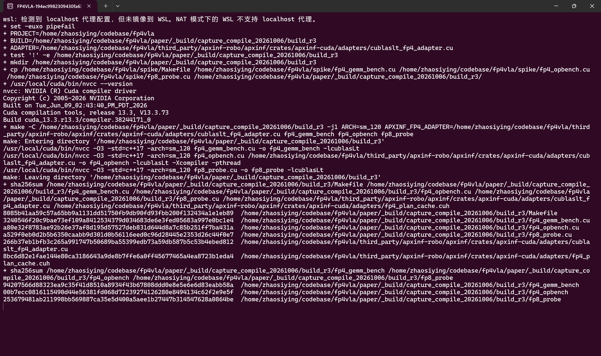

| 环节 | 执行截图或登记状态 |
|---|---|
| 运行截图 01　已完成教师演示来源核验 | 待补本轮真实运行截图 |
| 运行截图 02　已完成 RTN 配方与编码预算核验 | 待补本轮真实运行截图 |
| 运行截图 03　π0.5 单层 NVFP4 打包（CPU smoke） | 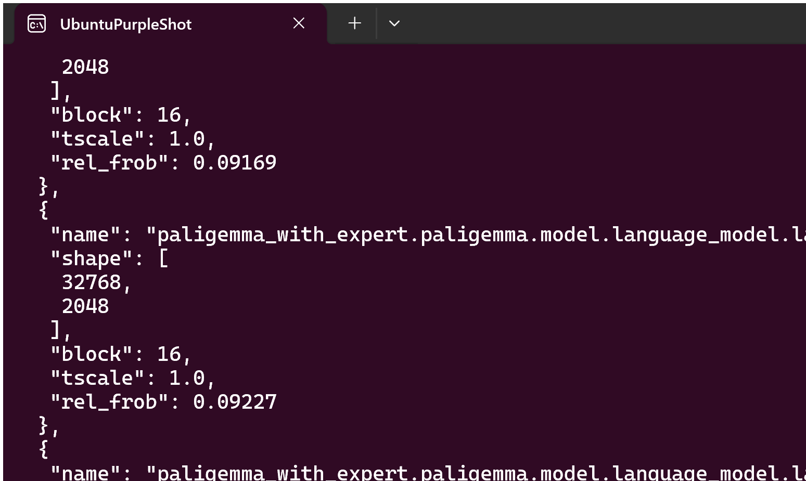 |
| 运行截图 04　教师探针、有效动作掩码与尾批梯度检查（CPU） | 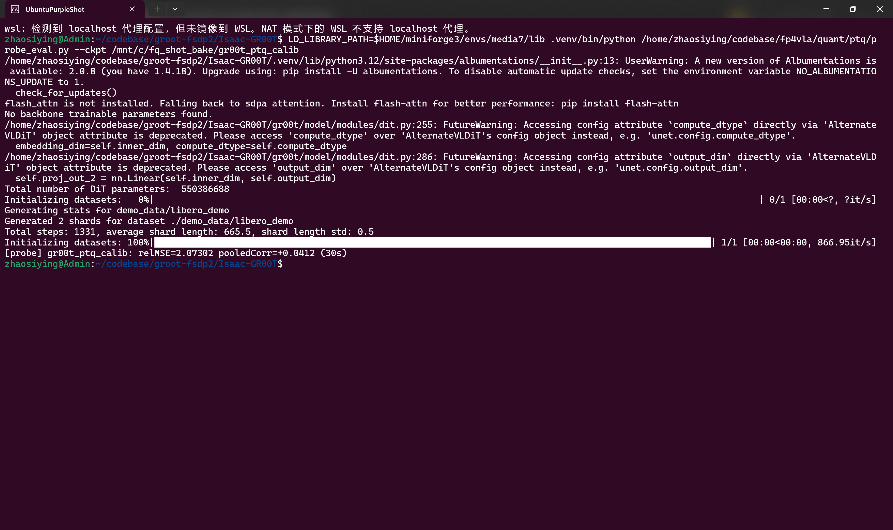 |
| 运行截图 05　已完成 QAD 训练证据核验 | 待补本轮真实运行截图 |
| 运行截图 06　已完成教师缓存证据核验 | 待补本轮真实运行截图 |
| 运行截图 07　已完成 OPD 续训证据核验 | 待补本轮真实运行截图 |
| 运行截图 08　恢复训练的激活重算与 LoRA 梯度检查（CPU 小模型） | 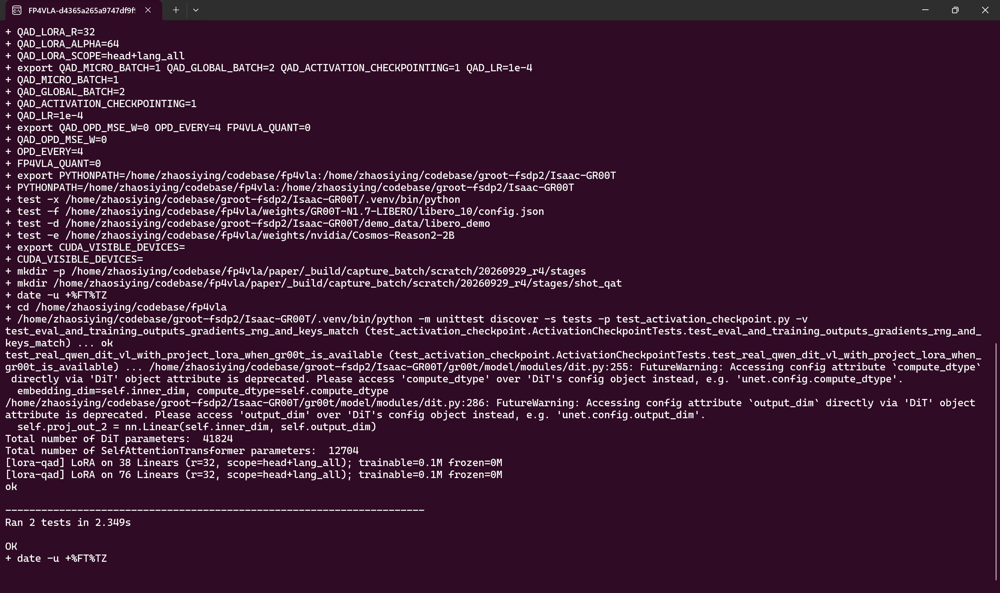 |
| 运行截图 09　已完成正式评测服务日志核验 | 待补本轮真实运行截图 |
| 运行截图 10　已完成学生闭环采集证据核验 | 待补本轮真实运行截图 |
| 运行截图 11　量化格点与最小 checkpoint 导出测试（CPU smoke） | 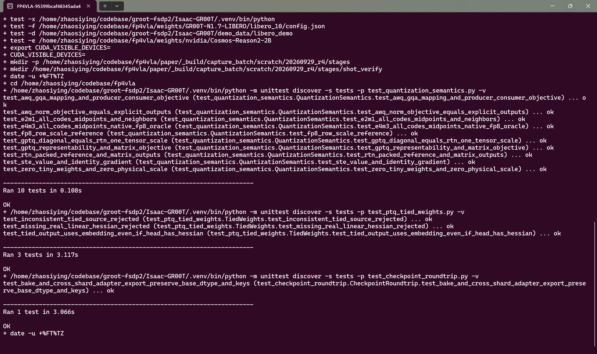 |
| 运行截图 12　FP8 描述符可用性与同步返回状态（GPU 探针） | 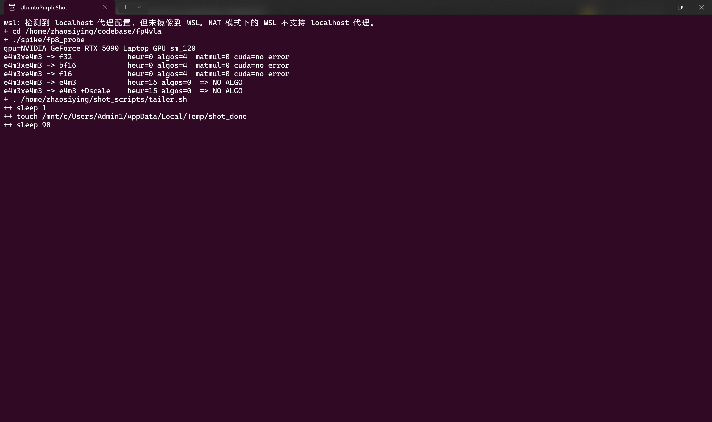 |
| 运行截图 13　9 种矩阵形状的短 GEMM sweep（每项 5 次） | 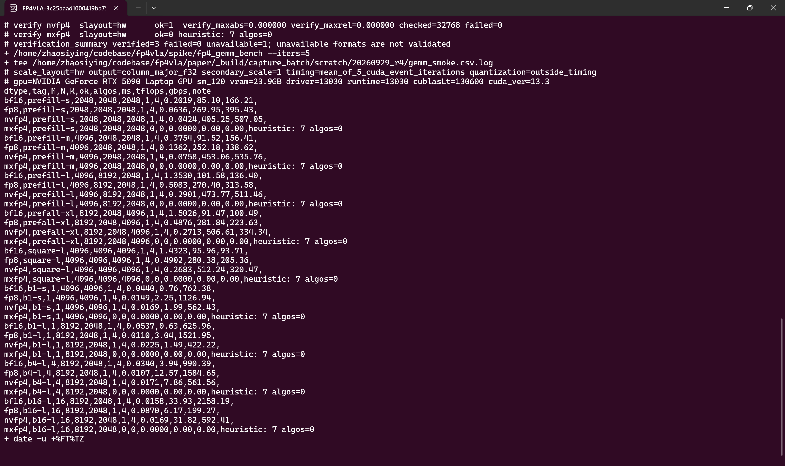 |
| 运行截图 14　18 个实际层形状的短算子测量（预热 1、采样 3） | 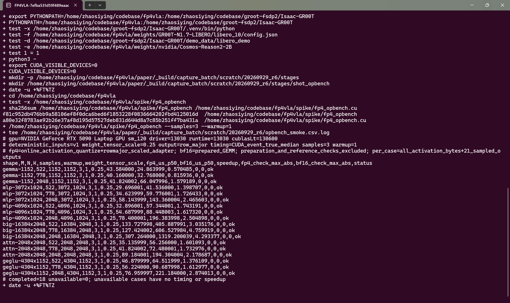 |
| 运行截图 15　GR00T BF16 执行流程展示 | 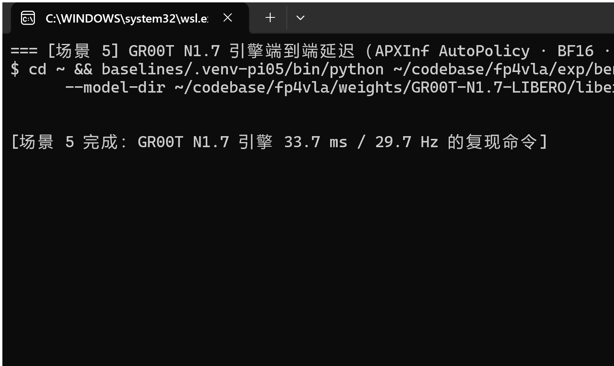 |
| 运行截图 16　π0.5 BF16 执行流程展示 | 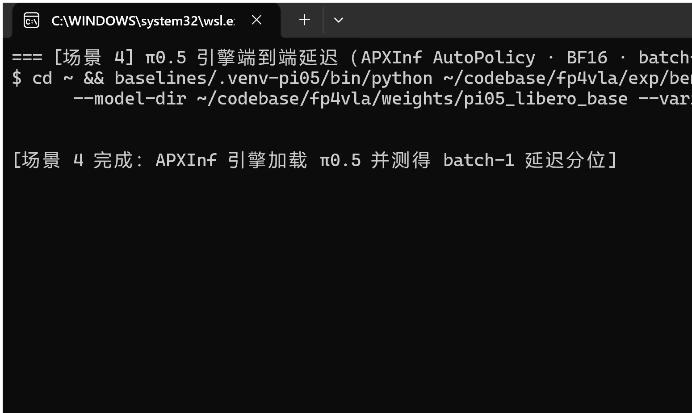 |
| 运行截图 17　π0.5 NVFP4 模型路径短测（预热 1、采样 2） | 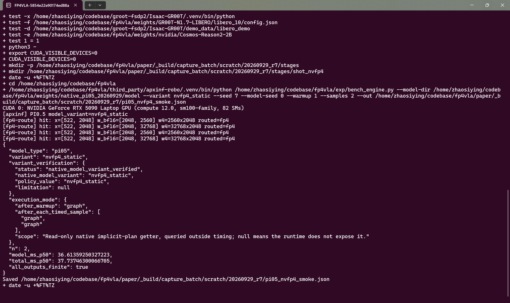 |

## 项目结构

```text
quant/    NVFP4 表示、校准、RTN/GPTQ 与权重写盘
rl/       QAD、学生状态采集、教师缓存、OPD 与 LoRA 导出
eval/     GR00T 服务、LIBERO 回合评测与配对比较
exp/      实验协议、选择与恢复驱动
setup/    环境、权重、APXInf 编译和锁文件
paper/    论文、知乎稿、图表、截图与可复算证据
docs/     复现说明及设计审阅
```

## 总结与适用范围

全 NVFP4 W4A4 基座加 BF16 LoRA 的净编码压缩为 3.276×。QAD 的总成功率点估计回到 BF16；OPD 未超过 QAD，但相对同演示预算的继续训练保留了更多闭环能力。训练步数不足、过拟合或缓存分布偏移只能列为待验证解释，现有消融不能确定原因。

结果限定于一个训练种子、LIBERO-10 的固定十任务与评测初态，不证明跨任务、跨种子或实机泛化，也不证明优于 QVLA/PTQ SOTA 或获得原生 GR00T 加速。全部实验和指标已冻结，后续交付只补齐七张真实核验截图与发布校验。

## 许可证与引用

当前仓库没有项目自有 LICENSE 文件。代码、补丁、模型与数据遵循各自上游许可。引用时请保留模型与数据来源、[论文](paper/paper.html)和[实验协议](exp/recovery_protocol_v12_rtn_w4a4.json)；对应科学证据见 [最终清单](paper/evidence/final_manifest.json)，发布截图登记尚待补齐。
